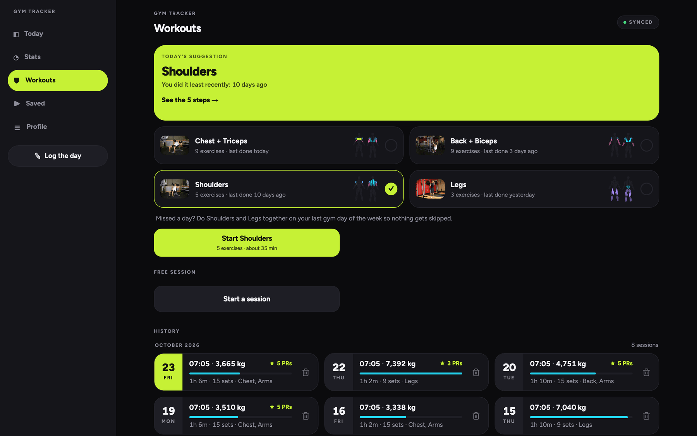

<p align="center">
  
</p>

<h1 align="center">Gym Tracker</h1>

<p align="center">
  <b>Your gym log, even with no signal.</b><br>
  A personal gym log that replaces the spreadsheet. It installs on an iPhone, works in the gym with no network and syncs when you are back online.
</p>

<p align="center">
  
  
  
  
  <a href="https://github.com/Sumonta056/gym-tracker/issues"></a>
</p>

<p align="center">
  <a href="https://sumonta056.github.io/gym-tracker/"><b>Website</b></a> ·
  <a href="https://sumonta056.github.io/gym-tracker/#demo"><b>Live demo</b></a> ·
  <a href="#install"><b>Install</b></a>
</p>

<p align="center">
  
</p>

<p align="center">
  
</p>

---

## Contents

- [Why Gym Tracker](#why-gym-tracker)
- [Features](#features)
- [Live demo](#live-demo)
- [Install](#install)
- [Quick start for developers](#quick-start-for-developers)
- [How it works](#how-it-works)
- [Tests](#tests)
- [Website](#website)
- [Changelog](#changelog)

## Why Gym Tracker

The gym log lived in an Excel sheet. A sheet is hard to fill in on a phone, between sets, in a basement with no signal. Gym Tracker fixes that:

- **It replaces the spreadsheet.** The 8 columns of the old sheet are one form, and the CSV import brings the old rows with you.
- **It works with no network in the gym.** Every save lands on the phone first. The outbox pushes it when the network comes back.
- **It installs on an iPhone.** No App Store. Add it to the Home Screen from Safari and it opens full screen. It also works on a laptop.
- **Each account sees only its own rows.** Registration is open. Every table on the server has a rule: a row is visible only to the account that owns it.

## Features

### Today

The home screen shows the day at a glance. Gym time is the hero number, with your streak, the day's stats and how far you are from each goal.

- Gym time from your finished sessions, or the time you type.
- Steps, calories, weight and walk time against your goals.
- Heart rate zones from your maximum heart rate.
- Week totals: sessions, gym minutes, calories, steps.
- Go back to any earlier day with the arrows or the date picker in the top bar.

<p align="center">
  
</p>

### Log days

The 8 columns of the old sheet, as one form: walk time, gym time, heart rate, weight, calories and steps. Go back to any earlier day and fix it.

- Previous and next day, a date picker and heat map links.
- A duration picker with presets and −15 s / +15 s, no keyboard.
- A swim time and a note for the day.
- A Saved toast after every save.


### Stats and charts

Day, Week and Month tabs. Every chart has day labels, value labels, a goal or average line, and reads well on the first day as on a full month.

- Weight with a 7-day moving average.
- Volume load per session and estimated one-rep max.
- Personal records, muscle group balance, gaps between sessions.
- Edit mode: reorder and hide cards, saved to your profile.


<p align="center">
  
</p>

### Live workout

Start a session and log each set as you lift. A timer runs, a rest timer counts down, and the volume adds up on screen.

- Exercise picker with search, a muscle filter and a recent list.
- Set rows with reps and weight; untick with undo.
- A summary with new records when you finish.
- Every past session in the Workouts history.



### Coach plans and muscle map

4 coach plans, 26 exercises, one exercise per screen. The app suggests the plan you did least recently, and you can join 2 plans on a day you missed.

- Start and end photos, the how-to and a muscle map per step.
- A tutorial link on YouTube for every exercise.
- Next, Back and Skip; the step list beside the step on a laptop.
- A Done screen: steps, sets, volume and new records.


<p align="center">
  
</p>

### Saved videos

Keep the Instagram Reels and YouTube videos you find, grouped by your own categories. Tap a card and the video opens in its own app.

- A title, 1 category, tags and a priority per video.
- High first, then Normal, then Low.
- Filter by category, search titles and tags.
- Edit and delete, with undo.


<p align="center">
  
</p>

### CSV import

Bring the old sheet with you. The sheet mixed `15.54`, `1:03:13` and `01.44.50`; the importer guesses each format and stores whole seconds.

- Every unclear row is flagged, and only those.
- Fix the rows on a review screen before anything is saved.
- A result screen says what was added.
- Export every table as CSV in one zip, read from this device. Works offline.

The import shows in Profile only when the build sets `NEXT_PUBLIC_ENABLE_CSV_IMPORT=1`.

<p align="center">
  
</p>

### Offline sync

Every save lands on your phone first, so the app never waits for the network. A chip on every data screen says where your data is.

- Saves work in flight mode, in a basement gym, anywhere.
- The outbox pushes when the network comes back.
- A retry never makes a duplicate row.

### Install on iPhone

No App Store. Open the app in Safari and add it to your Home Screen. It then opens full screen, like any other app, and logs offline. The steps are under [Install](#install).

## Live demo

**[Walk through every screen](https://sumonta056.github.io/gym-tracker/#demo)** on the website. The demo is the design prototype, the visual contract the app is built against: every screen at phone size, and the big ones at laptop size. It saves nothing, so scroll freely. Open it full screen at [`demo/`](https://sumonta056.github.io/gym-tracker/demo/).

## Install

The app is free, with open registration: **<https://gym-tracker-ten-gamma.vercel.app>**

**On an iPhone:**

1. Open the address in **Safari**. Other browsers on iPhone cannot add an app to the Home Screen.
2. Tap **Create an account**: your name, email and a password of 8 or more characters. Your rows belong to this account only.
3. Tap **Share**, the square with an arrow, in the Safari toolbar.
4. Scroll the share sheet and tap **Add to Home Screen**, then **Add**.
5. Open it from the Home Screen. It opens full screen with no browser bar. Turn on flight mode and log a set: it syncs when you are back online.

**On a laptop:** open the same address in any current browser. At 1024 px and wider the app shows a sidebar and up to 3 columns. Your data is the same on both.

## Quick start for developers

Needs Node 24 (the exact version is in `.nvmrc`, `24.21.0`) and pnpm 10, and a Supabase project.

```sh
git clone https://github.com/Sumonta056/gym-tracker.git
cd gym-tracker
pnpm install
cp .env.example .env.local
pnpm dev
```

Fill in `.env.local`:

| Variable                        | What it is                                                   |
| ------------------------------- | ------------------------------------------------------------ |
| `NEXT_PUBLIC_SUPABASE_URL`      | Your Supabase project URL. Required.                         |
| `NEXT_PUBLIC_SUPABASE_ANON_KEY` | Your Supabase anon key. Required.                            |
| `SUPABASE_PROJECT_ID`           | Your project id. `pnpm types:db` needs it to generate types. |
| `SUPABASE_DB_URL`               | Not read by the app or any script today. Leave it empty.     |

Two optional flags: `NEXT_PUBLIC_ENABLE_CSV_IMPORT=1` shows the CSV import in Profile, and `NEXT_PUBLIC_ENABLE_STYLEGUIDE=1` turns on the `/styleguide` route.

The database schema is in `supabase/migrations/`. The signed-in end-to-end tests use a test account: put `E2E_EMAIL` and `E2E_PASSWORD` in `.env.test.local`.

## How it works

Gym Tracker is offline first. No screen talks to the server. Every save goes to a database inside the browser and returns at once; a sync worker pushes it later.

```
screen → lib/db/repository.ts → Dexie (IndexedDB) + outbox → lib/sync/worker.ts → Supabase
```

- **The repository writes to Dexie and returns at once.** The row and its outbox entry share one transaction: never one without the other.
- **Only `lib/sync/worker.ts` talks to Supabase.** It drains the outbox when the app starts, when the network comes back, and every 30 seconds while online. ESLint stops any screen from importing Supabase.
- **The client makes every `id` as a UUID**, before the write. An offline save keeps its identity when it syncs, so a retry never makes a duplicate row.
- **A delete is a mark, not a removal.** It sets `deleted_at`, so it syncs too.
- **Every table has a Row Level Security policy** of `user_id = auth.uid()`. Each account sees only its own rows.
- **Durations are whole seconds and weight is metric** in storage. `lib/duration.ts` owns every parse and format.

```
app/                   Next.js App Router routes
  (app)/               Signed-in screens: Today, log, analytics, workout(s), saved, profile
  (auth)/              Sign in and sign up
  styleguide/          Every primitive, checked against the prototype
  sw.ts                The service worker (Serwist)
components/            Screens and primitives, one folder per area (ui, charts, plans, saved …)
lib/
  db/                  Dexie schema and the repository: the only data door for a screen
  sync/                The outbox and the sync worker: the only code that calls Supabase
  schema/              One zod schema per entity, shared by forms, the outbox and the import
  metrics/             Every derived number: streak, volume, records, plan suggestion
  csv/                 The sheet import and the zip export
  duration.ts          Every duration parse and format
supabase/migrations/   The SQL schema with its Row Level Security policies
public/                Icons and the exercise images, precached for the gym
tests/e2e/             Playwright specs
docs/                  Specs, phase plans, the design prototype and the source data
scripts/               The design check, the test rule, the commit report and the website build
site/                  Website and screenshots (deployed to GitHub Pages)
```

The full rules, with the allowed and forbidden imports: [`.claude/rules/architecture.md`](.claude/rules/architecture.md).

## Tests

Vitest for units, Playwright for the browser, on 3 projects: iPhone 14, Pixel 7 and desktop 1440.

```sh
pnpm static     # format, lint, typecheck, the design check and the test rule
pnpm test:cov   # unit tests with the coverage floors
pnpm e2e        # the end-to-end suite; axe must report no serious or critical issue
pnpm verify     # all of the above, plus the production build
```

Every source file under `lib/`, `components/` and `app/` has a test beside it; `pnpm test:required` fails when one is missing. The coverage floors fail the run:

| Path              | Lines | Branches | Functions |
| ----------------- | ----- | -------- | --------- |
| `lib/duration.ts` | 100   | 100      | 100       |
| `lib/metrics/**`  | 100   | 95       | 100       |
| `lib/sync/**`     | 95    | 90       | 95        |
| `lib/**` (rest)   | 85    | 75       | 85        |
| `components/**`   | 85    | 75       | 85        |
| `app/**`          | 85    | 75       | 85        |

Full detail: [`.claude/rules/testing.md`](.claude/rules/testing.md).

## Website

The website lives in `site/` and deploys to <https://sumonta056.github.io/gym-tracker/>.

- **`pnpm site:build`** copies `site/` to `_site/`, and copies the design prototype `docs/design/prototype/index.html` to `_site/demo/` as the live demo.
- **`pnpm site:shots`** captures `site/screenshots/` from the real app. It signs in the test account, blocks every Supabase write, and writes 1440 px shots at 1800 px wide and 390 px shots at 780 px wide. `--only today-390,saved-1440` takes a few; `--build` builds the app first.
- **`pnpm site:check`** fails when a `feat` commit under `app/` or `components/` lands with no change to `site/` or `README.md`. A feat with nothing to show adds `Site-update: none` to its commit body. CI runs it on every push to `main`.
- **`.github/workflows/pages.yml`** builds and deploys `_site/` after the `CI` workflow passes on a push to `main`.

**The image licence rule.** The coach photos in `docs/data/coach-images/` and `public/exercises/` have an unknown source. They never reach the website. The demo and the screenshots use the public domain photos of Free Exercise DB in `docs/data/fedb-images/` instead, and the build fails if a coach image reaches `_site/`.

## Changelog

- **Phase 4: saved videos** (2026-10-23)
  - A Saved tab for the Instagram Reels and YouTube videos you find, by your own categories.
  - A title, tags and a priority per video; search, filter, edit, and delete with undo.
  - Profile moves to an avatar in the header.
- **Phase 3: coach plans** (2026-10-21)
  - 4 coach plans, 26 exercises, one guided step per screen with start and end photos and a muscle map.
  - A tutorial link on YouTube for every exercise; the plan you did least recently is suggested.
  - Join 2 plans on a day you missed; a Done screen with steps, sets, volume and new records.
  - The step images are cached for the gym, so a plan works offline.
- **The day view** (2026-10-19)
  - The Today screen reads any day, with a date control in the top bar.
- **Owner feedback fixes** (2026-10-16)
  - A Reload screen instead of a blank page, and an error list in Profile.
  - A duration picker, gym time from your sessions, old days in the log and a swim time.
  - A summary when a session ends, and a session history.
  - Goals in Profile with goal lines on the charts; heart rate zones with bpm ranges.
  - Reorder and hide the Stats cards.
- **Email registration** (2026-10-04)
  - Open registration: create an account with a name, email and password.
- **Phase 2: live workout and CSV import** (2026-10-04)
  - Log a session set by set, with a rest timer, set edit and undo.
  - Volume, one-rep max, records, muscle balance and gap charts.
  - Import the old sheet with a review screen; export every table as CSV in one zip.
- **Phase 1: daily tracker** (2026-09-25)
  - Log the day; the Today dashboard; the analytics charts; Profile with a clean sign-out.
  - Offline first: saves land on the device and sync when online.
  - Installs on an iPhone; a sidebar layout on a laptop.
- **Phase 0: foundation** (2026-09-20)
  - The toolchain, the design system, the design prototype and the commit gate.
