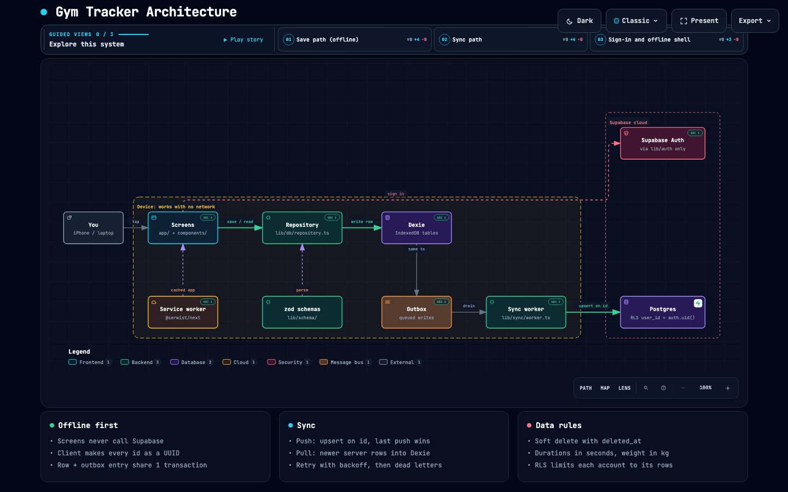

# Architecture

How a save moves from a screen to Supabase, and what Dexie, the outbox and the sync
worker do.



The flow in one line:

**Screen → Repository → Dexie (row + outbox in 1 transaction) → Sync worker → Supabase
Postgres**

## How a save moves

1. **You tap Save on a screen.** All screens are under `app/` and `components/`. A
   screen never talks to Supabase. It only calls `lib/db/repository.ts`. ESLint
   enforces this rule.
2. **The repository checks the data.** It uses the zod schema in `lib/schema/`. The
   form, the outbox and the CSV importer all use that same schema.
3. **The repository writes to Dexie and returns at once.** The client makes the row
   `id` as a UUID before the write. The row and its outbox entry go into **one
   transaction**, so one cannot exist without the other. The save works with no
   network.
4. **The sync worker drains the outbox.** `lib/sync/worker.ts` is the only code that
   talks to the Supabase database. It sends each row as an upsert on `id`. A retry
   therefore cannot make a duplicate row.
5. **Supabase stores the row.** Row Level Security (RLS) checks
   `user_id = auth.uid()`, so each account sees only its own rows.
6. **The worker pulls server rows back.** A newer server row replaces the local row. A
   local row that still has a queued write stays as it is.

The 2 side paths:

- **Sign-in:** only `lib/auth/**` may call Supabase Auth.
- **Offline shell:** the service worker (`app/sw.ts`, `@serwist/next`) caches the app.
  The app opens in the gym with no network.

## Dexie: the database on the device

Every browser has a small database, IndexedDB. Its API is hard to use. **Dexie** is a
library that makes IndexedDB easy to use.

The app keeps **all the data on the device** in Dexie: days, workouts, sets, plans and
saved videos. `lib/db/dexie.ts` lists the tables and the schema versions.

- The screens read from Dexie, not from the internet. The app is fast and works in the
  gym with no signal.
- A save writes to Dexie and ends in milliseconds. It never waits for the network.

Dexie is **the source of truth for the screen**. Supabase is the backup and the link
between devices.

## Outbox: the "to send" list

The **outbox** is one more Dexie table (`lib/sync/outbox.ts`). It is a list of writes
that the server has not received yet.

It works like the Outbox folder in an email app. An email sent on a plane waits in the
Outbox and goes out after the landing.

A save of a set does 2 writes in **1 transaction**:

1. The repository writes the row to its Dexie table.
2. The repository adds an outbox entry, for example "upsert this set, id = abc-123".

Both writes happen, or neither happens. There is never a saved row that the server will
not get. There is never an outbox entry for a row that does not exist.

Each entry has:

- a **sequence number**, so the entries go to the server in the order they were made.
- an **attempt count** and a **backoff** (`backoffMs`, max 60 s). A failed entry waits
  longer before each new try.

## Sync worker: the courier

`lib/sync/worker.ts` is **the only code that talks to the Supabase database**. It has 2
jobs.

**Push (device → server):**

1. It takes the next due entry from the outbox (`nextPending`).
2. It sends the row to Supabase as an **upsert on `id`**. The device made the `id` (a
   UUID), so a retry of the same row cannot make a duplicate.
3. On success, it removes the entry (`markDone`). On failure, it adds 1 to the attempt
   count and sets a backoff (`markFailed`).
4. At 20 attempts, the entry moves to the **dead letters**. The user can retry those by
   hand.

**Pull (server → device):**

1. It asks Supabase for rows that changed since the last pull, 1,000 rows per page
   (`PULL_PAGE_ROWS`).
2. It writes newer rows into Dexie. A local row that still has a queued write in the
   outbox stays as it is.

**When it runs:**

- when the app starts
- every 30 s (`SYNC_INTERVAL_MS`)
- when the network comes back (the `online` event). This run does not wait for the
  backoff.
- when the user presses "Sync now"

**Safety with many tabs:** the worker takes a browser lock (`DRAIN_LOCK`). Only 1 tab
can send the outbox at a time.

## All together

```
Tap Save
  └─ Repository ──1 transaction──► Dexie row + Outbox entry   (done, screen updates)
                                          │
              (later: timer / online / Sync now)
                                          ▼
                                    Sync worker ──upsert on id──► Supabase
                                          ▲                          │
                                          └────── pull newer rows ───┘
```

The screen only knows Dexie. The worker keeps Dexie and Supabase the same in the
background.

## Design choices

- **Offline first:** a write never waits for the network. The outbox holds the write
  until the network comes back.
- **Safe retries:** the client makes the UUID, so a retry sends the same `id` and the
  upsert does not make a second row.
- **Last push wins:** the server keeps the push that arrives last. This is on purpose,
  because each account has 1 person.
- **Soft delete:** a delete only sets `deleted_at`, because a hard delete does not sync.
- **Units:** durations are stored in seconds and weight in kg.

The full rules are in `.claude/rules/architecture.md`.
